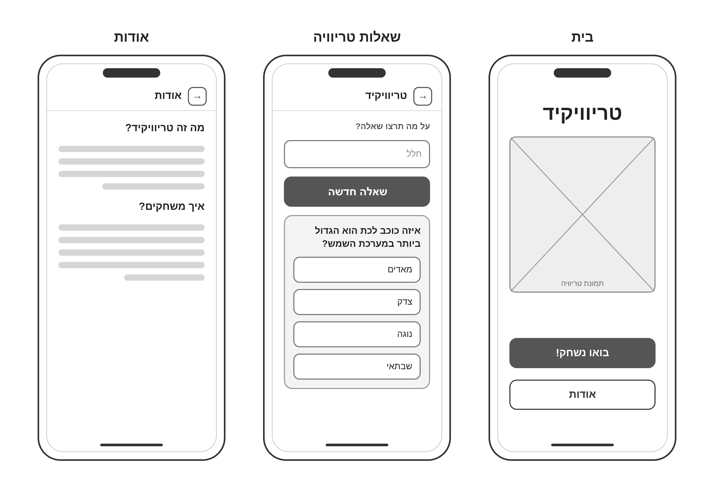
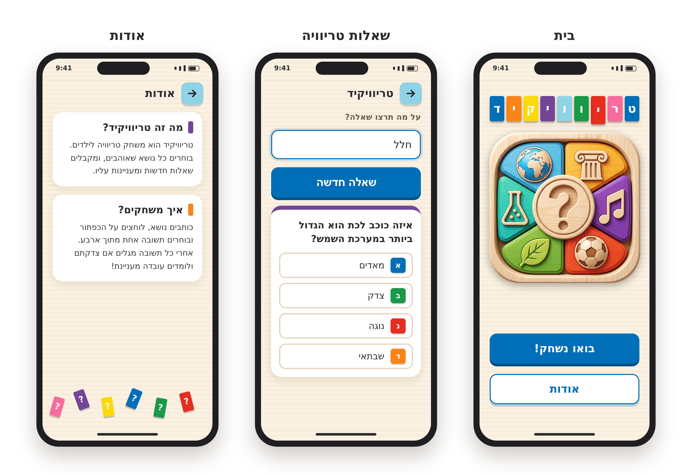
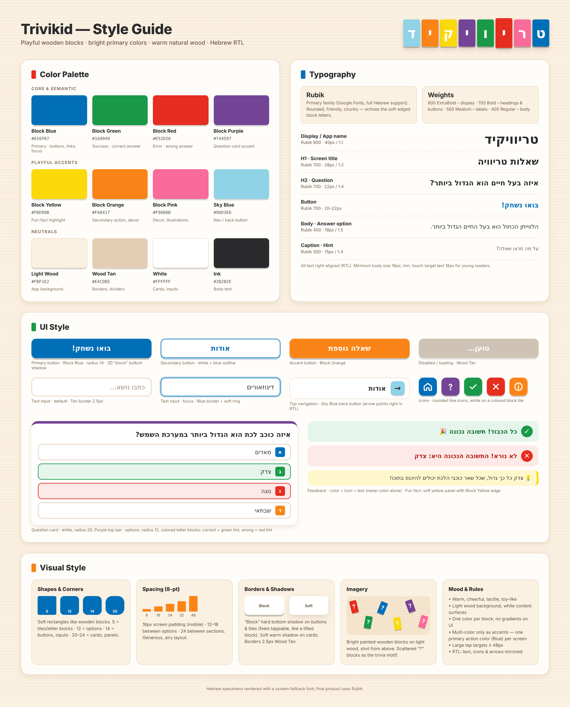
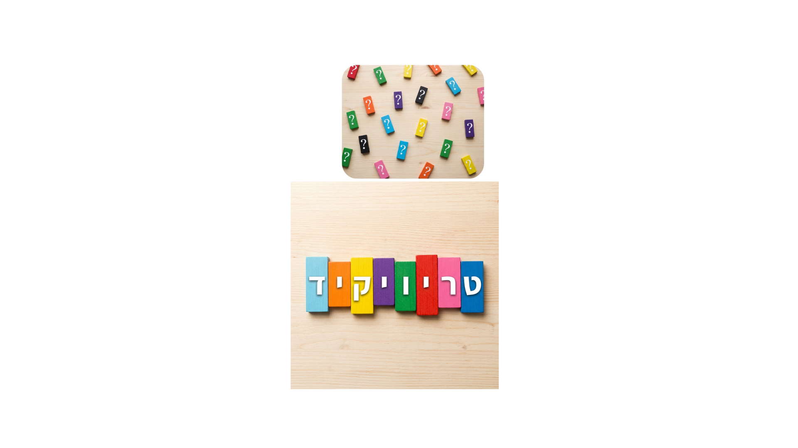

# Design (UI / UX) — טריוויקיד (Trivikid)

> The application's design, in two parts: the **Screens** and the **Style Guide**. It is based on PRD.md and on the three reference images in this folder. Product requirements and UX principles are documented in the PRD and are not repeated here.

## 1. Screens

### Wireframes (structure and layout)

### Mockups (final look)

All screens are designed mobile-first in a phone frame (about 360 × 780 px), in Hebrew, right-to-left. Every screen uses the same light-wood background (see Style Guide).

### Screen list

#### בית (Home)
- **Screen purpose:** The entry point. The child sees the app's name and picture and chooses to start playing or to read about the app.
- **Structure and content (top to bottom):**
  - **App name "טריוויקיד":** shown as a row of 9 colored wooden letter blocks, one Hebrew letter per block, with white letters, centered near the top. The block colors in reading order (right to left) are:
    - ט Blue
    - ר Pink
    - י Red, slightly taller than the others
    - ו Green
    - ו Sky Blue
    - י Purple
    - ק Yellow
    - י Orange
    - ד Blue
  - **Hero picture (`home-image.png`):** a large, centered square picture of a wooden tray with six colored segments (globe, column, flask, music note, leaf and ball symbols) around a central wooden "?" coin. It is displayed on the wood background with a soft drop shadow, without a card or border.
  - **Spacing:** flexible empty space between the picture and the buttons pushes the buttons toward the bottom of the screen.
  - **"בואו נשחק!" button:** primary button, full width.
  - **"אודות" button:** secondary button, full width, below the primary button.
- **Actions and navigation:**
  - "בואו נשחק!" → שאלות טריוויה.
  - "אודות" → אודות.

#### שאלות טריוויה (Trivia Questions)
- **Screen purpose:** The child types a topic, requests a question, and answers it.
- **Structure and content (top to bottom):**
  - **Top bar:**
    - A Sky Blue back button with a right-pointing arrow at the start (right) side.
    - Next to it, the title "טריוויקיד".
  - **Topic label:** "על מה תרצו שאלה?"
  - **Topic text input:** full width; it shows the typed topic (e.g., "חלל"). The Mockup shows it in its focus style.
  - **"שאלה חדשה" button:** primary button, full width. It is the screen's only request button: it asks for the first question, another question on the same topic, or a question on an edited topic.
  - **Question card:**
    - A white card with a purple top bar.
    - The question text in bold.
    - Below it, 4 answer options stacked vertically. Each option is a full-width row with a small colored letter block at the start (א Blue, ב Green, ג Red, ד Orange), followed by the answer text.
  - **Decoration:** a row of scattered colored "?" tiles at the bottom of the screen.
- **Additional elements not shown in the Wireframes or Mockups:** these follow the PRD flow and are styled per the Style Guide.
  - **Feedback after answering:** once the child taps an option, the 4 options disappear and, inside the question card below the question text, are replaced by (top to bottom):
    - the success message, or the failure message including the correct answer;
    - the explanation (fun-fact) panel.
  - The loading and disabled states.
  - The error and empty-topic messages.
- **Actions and navigation:**
  - Type or edit the topic, then tap "שאלה חדשה".
  - Tap one answer option.
  - After feedback, tap "שאלה חדשה" again (same topic) or edit the topic and tap it (new topic).
  - Back button → בית.

#### אודות (About)
- **Screen purpose:** Explains what the app is and how to play.
- **Structure and content (top to bottom):**
  - **Top bar:** a Sky Blue back button with a right-pointing arrow, and the title "אודות".
  - **Two white content cards**, each with a heading that has a small colored bar beside it, followed by body text:
    - "מה זה טריוויקיד?" (purple bar): "טריוויקיד הוא משחק טריוויה לילדים. בוחרים כל נושא שאוהבים, ומקבלים שאלות חדשות ומעניינות עליו."
    - "איך משחקים?" (orange bar): "כותבים נושא, לוחצים על הכפתור ובוחרים תשובה אחת מתוך ארבע. אחרי כל תשובה מגלים אם צדקתם ולומדים עובדה מעניינת!"
  - **Decoration:** a row of scattered colored "?" tiles at the bottom of the screen.
- **Actions and navigation:** Back button → בית.

### Navigation structure
- **בית** is the hub. It links to **שאלות טריוויה** ("בואו נשחק!") and to **אודות** ("אודות").
- **שאלות טריוויה** and **אודות** each have a back button in the top bar that returns to **בית**.
- There is no persistent navigation bar or menu.

---

## 2. Style Guide

**Overall direction:** painted wooden toy blocks on light natural wood. The look is bright, cheerful and tactile, based on the product's inspiration board:

The inspiration board is mood and background only. Where it differs from the Style Guide or the Mockups, those win.

### Color Palette

| Color / role | HEX |
|--------------|-----|
| Block Blue — primary: main buttons, links, input focus | `#016FB7` |
| Block Green — success / correct answer | `#1A9949` |
| Block Red — error / wrong answer | `#E52D20` |
| Block Purple — question card accent | `#744597` |
| Block Yellow — fun-fact highlight | `#FBD90B` |
| Block Orange — accent, decoration | `#FA8417` |
| Block Pink — decoration, illustrations | `#F96B9B` |
| Sky Blue — back button | `#90D3E6` |
| Light Wood — app background | `#FBF1E2` |
| Wood Tan — borders, dividers, disabled state | `#E4CDB5` |
| White — cards, inputs, secondary button | `#FFFFFF` |
| Ink — body text | `#2B2B2E` |

**Usage rules:**
- Each block or tile uses a single flat color.
- Multi-color is used for accents only (letter blocks, option keys, "?" tiles).
- Each screen has one primary action color, Blue.
- Success and failure are always shown with color plus an icon plus text, never color alone.

### Typography
- **Font family:** **Rubik** (Google Fonts, full Hebrew support), with a system sans-serif fallback.
  - Weights: 800 ExtraBold for display, 700 Bold for headings and buttons, 500 Medium for labels, 400 Regular for body text.
  - Note: the Style Guide and Mockup images were rendered with a substitute font; the implementation uses Rubik.

| Style | Weight · size / line height | Example |
|-------|-----------------------------|---------|
| Display / app name | 800 · 40px / 1.1 | טריוויקיד |
| H1 · screen title | 700 · 28px / 1.2 | שאלות טריוויה |
| H2 · question | 700 · 22px / 1.4 | איזה כוכב לכת הוא הגדול ביותר במערכת השמש? |
| Button | 700 · 20–22px | בואו נשחק! |
| Body · answer option | 400 · 18px / 1.5 | צדק |
| Caption · hint / label | 500 · 15px / 1.4 | על מה תרצו שאלה? |

- The minimum body text size is 16px.
- In the Mockups, the top-bar title is about 22px Bold, and the About card headings are about 20px Bold with 16px body text.

### UI Style
- **Buttons:**
  - All buttons share these traits: 60px high, full width on mobile, radius 14px, Bold 20–22px text.
  - Primary and secondary buttons have a hard bottom "block" shadow (about 5px), so they look like a lifted wooden block.
  - The style-guide image also shows an orange accent button ("שאלה נוספת"); it is not used, because "שאלה חדשה" is the only request button.

  | Type | Fill | Text | Border | Use |
  |------|------|------|--------|-----|
  | Primary | Block Blue | White | None | "בואו נשחק!", "שאלה חדשה" |
  | Secondary | White | Blue | 2.5px Block Blue | "אודות" |
  | Disabled / loading | Wood Tan | White | None | While a question loads, e.g. "טוען…" |

- **Text input:** white fill, 58px high, radius 14px, 20px text, right-aligned.
  - Default: 2.5px Wood Tan border.
  - Focus: 2.5px Block Blue border plus a soft blue outer ring.
- **Question card:** white, radius 20px, an 8px Block Purple top bar, a soft warm shadow, and about 16–20px of inner padding.
- **Answer options:**
  - Each option is a full-width row 50px high, with a white fill, a 2.5px Wood Tan border and a radius of 12px, spaced about 10px apart.
  - Each row starts with a 30px colored letter block (א Blue, ב Green, ג Red, ד Orange) with a white bold letter.
  - The options are replaced by the feedback after answering, so the green "correct" and red "wrong" option states shown in the style-guide image are not used.
- **Feedback messages:** these are rounded panels (radius 16px) with a circular icon and bold text.
  - They appear inside the question card, below the question, in place of the answer options.
  - Success: light green background (`#E6F5EC`), dark green text (`#11733A`), and a green circle with "✓". Text: "כל הכבוד! תשובה נכונה 🎉".
  - Failure: light red background (`#FDE9E7`), dark red text (`#B3241A`), and a red circle with "✕". Text: "לא נורא! התשובה הנכונה היא: …".
- **Fun-fact panel:** a soft yellow background (`#FFF7CC`), radius 14px, a 6px Block Yellow edge on the start (right) side, and a 💡 before 16px text.
- **Top navigation:** a Sky Blue square back button (44 × 44px, radius 12px, small block shadow) with a dark right-pointing arrow, followed by the screen title.
- **Icons:** rounded line icons. On their own they are drawn white on a colored block tile (radius about 14px).
- **Content cards (About):** white, radius 20px, soft warm shadow, and a small colored vertical bar beside the heading.

### Visual Style
- **Shapes and corners:** soft rectangles, like wooden blocks.

  | Radius | Used for |
  |--------|----------|
  | 4–5px | Letter blocks and "?" tiles |
  | 12px | Answer options and the back button |
  | 14px | Buttons and inputs |
  | 20–24px | Cards and panels |

- **Spacing:** an 8-point scale (8 / 16 / 24 / 32 / 48).
  - Screen side padding is about 16–20px on mobile.
  - Options are 10–16px apart, and stacked elements are about 16px apart.
  - Sections are about 24px apart.
  - The layout is generous and airy.
- **Shadows:**
  - A "block" hard bottom shadow on buttons, tiles and letter blocks.
  - A soft warm shadow (brownish, low opacity) on cards and the Home picture.
- **Borders:** 2.5px in Wood Tan by default, and Blue for focus or the secondary button.
- **Background:** Light Wood (`#FBF1E2`) with subtle horizontal wood-grain lines. White is used for content surfaces.
- **Imagery and illustration:**
  - **Home picture:** a stylized, 3D-rendered wooden tray with colored segments and a central "?" coin.
  - **Decorative motif:** small colored "?" tiles scattered at slight rotations along the bottom of the Trivia and About screens.
  - **App icon (`app-icon.png`, 1024 × 1024):** a simplified version of the Home picture, with a wooden frame, six colored segments and a large central wooden "?" coin, without the small symbols, so it stays clear at small sizes.
- **Atmosphere:** warm, cheerful, toy-like and tactile, with no gradients on UI controls. Touch targets are at least 48px.

### Language and Directionality
- **Interface language:** Hebrew only, so all UI text is in Hebrew.
- **Direction:** right-to-left on every screen (`lang="he"`, `dir="rtl"`).
  - Text, headings, inputs and answer options are right-aligned.
  - Layout uses start and end (logical) positioning, so the start side is the right.
- **Mirroring:**
  - The back button sits at the start (right) of the top bar, and its arrow points right.
  - Letter blocks in the app name and option key blocks sit at the start (right) of their rows.
  - The fun-fact panel's colored edge is on the start (right) side.
